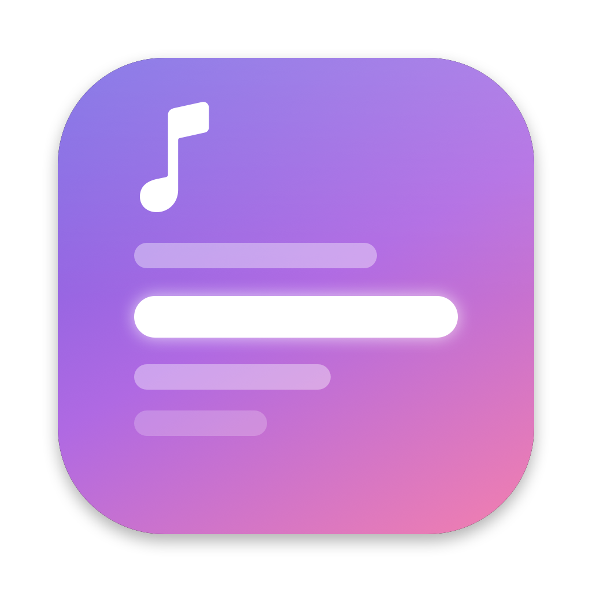
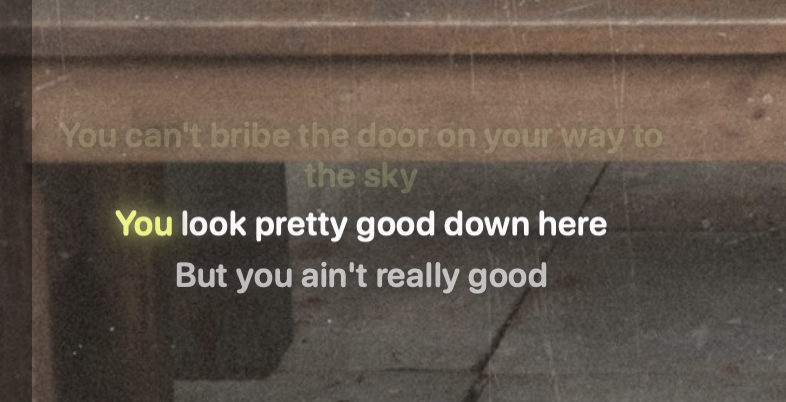
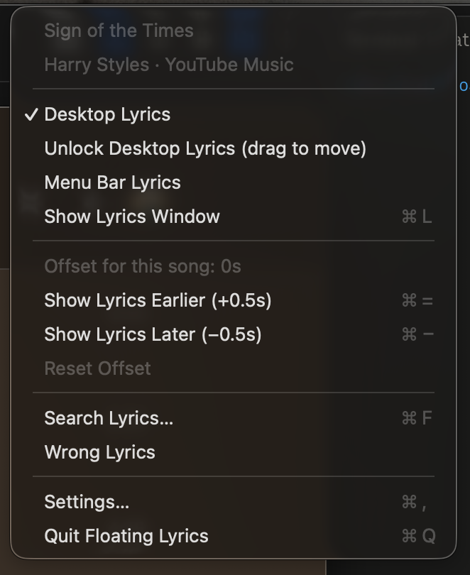
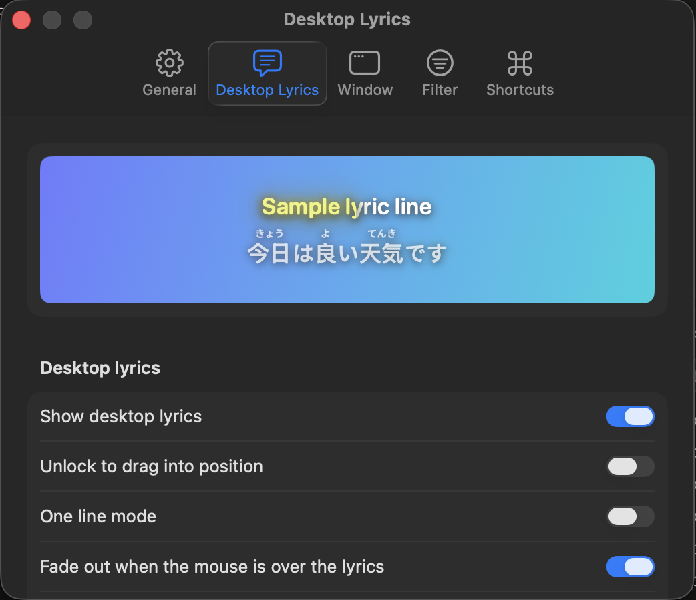

<p align="center">
  
</p>

<h1 align="center">Floating Lyrics</h1>

<p align="center">
  Synced, karaoke-style lyrics floating on your Mac desktop for Apple Music, Spotify and YouTube Music.
</p>

<p align="center">
  
</p>

---

## Contents

- [Features](#features)
- [Requirements](#requirements)
- [Install](#install)
  - [Homebrew (recommended)](#homebrew-recommended)
  - [Manual download](#manual-download)
  - ["Floating Lyrics can't be opened"](#floating-lyrics-cant-be-opened--apple-could-not-verify)
- [Setup](#setup)
  - [Apple Music and Spotify](#apple-music-and-spotify)
  - [YouTube Music (Pear Desktop)](#youtube-music-pear-desktop)
- [Usage](#usage)
  - [Default shortcuts](#default-shortcuts)
  - [Open with your music player](#open-with-your-music-player)
- [Build from source](#build-from-source)
  - [Project layout](#project-layout)
- [Privacy](#privacy)
- [Credits](#credits)
- [License](#license)

## Features

- **Desktop lyrics.** The current line floats above your windows and fills in as it's sung. You can change the font, size, colours, glow, shadow and background.
- **Menu bar lyrics.** Shows the current line in the menu bar.
- **Lyrics window.** Shows the full song. Double-click a line to jump the song to that point.
- **Works with Apple Music, Spotify and YouTube Music.** It follows whichever one is playing, or you can pick one.
- **Furigana** above kanji in Japanese lyrics.
- **Timing fixes.** Move the lyrics earlier or later for one song, or for all songs.
- **Search and "Wrong Lyrics".** Pick different lyrics when it finds the wrong ones.
- **Credit line filter.** Hides lines like `Composer: …`.
- **Global keyboard shortcuts.** They work from any app and you can change them.
- **Launch with your player.** Can open automatically when a music player starts and quit when it closes.

<p align="center">
  
  &nbsp;
  
</p>

Lyrics come from [LRCLIB](https://lrclib.net), a free and open lyrics database. You don't need an account or an API key.

## Requirements

- macOS 15 Sequoia or later
- Apple Music, [Spotify](https://www.spotify.com/download/mac/), or [Pear Desktop](https://github.com/pear-devs/pear-desktop) for YouTube Music

## Install

### Homebrew (recommended)

```bash
brew install --cask minhchienwikipedia/tap/floating-lyrics
```

To update later, run `brew upgrade --cask floating-lyrics`. Homebrew skips the "Apple could not verify…" warning for you.

### Manual download

1. Download the latest `FloatingLyrics-x.y.dmg` from the [Releases](../../releases) page.
2. Open the DMG and drag **Floating Lyrics** into **Applications**.
3. Open Floating Lyrics from Applications.

### "Floating Lyrics can't be opened" / "Apple could not verify…"

This only applies to the manual download. The app isn't signed with an Apple Developer ID, so macOS blocks it the first time. To allow it:

1. Try to open the app once and dismiss the warning.
2. Go to **System Settings → Privacy & Security** and scroll down.
3. Next to the message about Floating Lyrics, click **Open Anyway** and confirm.

Or run this once in Terminal:

```bash
xattr -dr com.apple.quarantine /Applications/FloatingLyrics.app
```

## Setup

Floating Lyrics runs in the **menu bar**, so look for the ♪ icon at the top of your screen. It has no Dock icon.

### Apple Music and Spotify

Start playing a song. The first time, macOS asks whether Floating Lyrics may control **Music** or **Spotify**. Click **Allow**, because that's how it reads the current song and playback position.

If you clicked **Don't Allow**, turn it back on in **System Settings → Privacy & Security → Automation → Floating Lyrics**.

### YouTube Music (Pear Desktop)

Floating Lyrics works with [Pear Desktop](https://github.com/pear-devs/pear-desktop), the open-source YouTube Music desktop app (formerly th-ch/youtube-music). It doesn't work with the YouTube Music website in a browser.

Pear Desktop needs its **API Server** plugin turned on and set to the port Floating Lyrics uses:

1. **Turn on the API Server.** In Pear Desktop's menu, open **Plugins → API Server** and check **Enabled**.
2. **Set the port.** In **Plugins → API Server**, open the **Port** setting and enter **`26538`**. Floating Lyrics only connects to this port, so make sure the setting is exactly that number.
3. **Choose the authorization mode.** Under **Authorization strategy**, either option works:
   - **Authorize at first request** (the default): Pear Desktop asks once whether to let **FloatingLyrics** connect. Click **Allow**.
   - **No authorization**: there's no prompt, but any app on your Mac, or device on your network, can read and control playback. Use it only on a network you trust.
4. **Restart Pear Desktop** so the new settings take effect.
5. Play a song. Lyrics should appear within a few seconds.

Floating Lyrics remembers the approval, so you only do this once.

<details>
<summary>Pear Desktop isn't showing lyrics?</summary>

- Make sure the **API Server** plugin is enabled, then restart Pear Desktop.
- Check the port is exactly **26538**.
- If you denied the connection, Floating Lyrics asks again about a minute later. You can also remove *FloatingLyrics* from the plugin's authorized clients and restart Floating Lyrics.
- Click the menu bar icon. The top line shows the song it can see and which player it came from.

</details>

## Usage

Click the ♪ menu bar icon to:

| Item | What it does |
| --- | --- |
| Desktop Lyrics | Show or hide the floating lyrics |
| Unlock Desktop Lyrics | Drag the lyrics to move them, or drag the corner to resize. Lock them again when you're done |
| Menu Bar Lyrics | Show the current line in the menu bar |
| Show Lyrics Window | Open the full lyrics for the song |
| Show Lyrics Earlier / Later | Shift timing by 0.5 s for **this song** (remembered) |
| Search Lyrics… / Wrong Lyrics | Find and choose different lyrics |
| Settings… | Appearance, player, timing, filter and shortcuts |

### Default shortcuts

These work from any app. Change them in **Settings → Shortcuts**.

| Shortcut | Action |
| --- | --- |
| ⌃⌥⌘ L | Show or hide desktop lyrics |
| ⌃⌥⌘ W | Show the lyrics window |
| ⌃⌥⌘ = | Show lyrics earlier (+0.5 s) |
| ⌃⌥⌘ − | Show lyrics later (−0.5 s) |

More actions (lock/unlock, menu bar lyrics, search, wrong lyrics, reset offset) have no shortcut by default. You can give them one in Settings.

### Open with your music player

In **Settings → General**, turn on **Open automatically when a music player starts**. If macOS asks, allow Floating Lyrics in **System Settings → General → Login Items**. Keep the app in Applications after you turn this on.

## Build from source

You need Xcode 16 or later, or the Swift 6 toolchain, on macOS 15 or later.

```bash
git clone https://github.com/minhchienwikipedia/floating-lyrics.git
```

```bash
cd floating-lyrics
```

Build the app into `build/FloatingLyrics.app`:

```bash
./build.sh
```

Build the app and the installer DMG into `build/FloatingLyrics-<version>.dmg`:

```bash
./make-dmg.sh
```

The first DMG build may ask to let Terminal control **Finder**. It uses that to lay out the installer window.

To change the app icon, edit `scripts/app-icon.swift`, then run `scripts/make-icon.sh`.

### Project layout

```
Sources/FloatingLyrics/        The app (SwiftUI + AppKit)
Sources/FloatingLyricsHelper/  Login-item helper for "open with player"
Resources/                     App icon
images/                        README screenshots
homebrew/                      Homebrew cask (copied to the tap on release)
scripts/                       Icon, DMG background and DMG icon generators
build.sh                       Builds and ad-hoc signs the .app
make-dmg.sh                    Packages the .app into a drag-to-install DMG
release.sh                     Publishes a GitHub release and updates the Homebrew tap
```

## Privacy

Floating Lyrics sends only the song's title, artist, album and length to LRCLIB to look up lyrics. It talks to Pear Desktop only on your own Mac (`127.0.0.1`). It has no analytics or tracking.

## Credits

- Inspired by [LyricsX](https://github.com/ddddxxx/LyricsX) by ddddxxx
- Lyrics from [LRCLIB](https://lrclib.net)
- YouTube Music support through the API Server plugin of [Pear Desktop](https://github.com/pear-devs/pear-desktop)

## License

[MIT](LICENSE)
